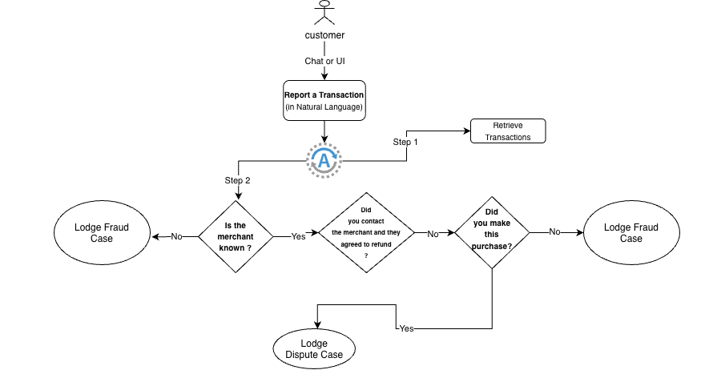

# Transaction Triage Assistant

A local-only demonstrator for reporting a bank transaction through chat. A customer describes a
mock transaction in natural language, selects a match, answers up to three deterministic triage
questions, reviews the proposed outcome, and explicitly confirms before receiving a local case ID.



## What it does

- React chat UI with a Westpac-styled greeting, transaction cards, triage cards, restart action, and
  explicit confirmation.
- FastAPI endpoints for customer messages and confirmed triage submissions:
  - `POST /exp-digiServicing-transctiontraige/v1/message`
  - `POST /exp-digiServicing-transctiontraige/v1/submission`
- Deterministic local merchant/amount matching and triage. No external LLM, database, banking API,
  or cloud service is used.
- Static mock data in `sample_data/transactions.json` (50 transactions for mock user `599`).
- Correlation-linked JSONL logs in `logs/`, including the mock user ID, submitted triage answers,
  outcome, and generated case ID.

## Prerequisites

- Python 3.12 or later
- [uv](https://docs.astral.sh/uv/)
- Node.js 20 or later and npm
- Access to the Westpac Python package index and system certificates when installing Python
  dependencies in this environment

## Setup

From a clean checkout at the repository root:

```bash
UV_DEFAULT_INDEX=https://artifactory.srv.westpac.com.au/artifactory/api/pypi/westpac-pypi/simple \
UV_SYSTEM_CERTS=true uv sync --directory src/api --extra dev
UV_DEFAULT_INDEX=https://artifactory.srv.westpac.com.au/artifactory/api/pypi/westpac-pypi/simple \
UV_SYSTEM_CERTS=true uv sync --directory src/agent --extra dev
npm --prefix src/ui ci
```

## Run the solution

Start the API in one terminal:

```bash
uv run --directory src/api uvicorn api.app:app --host 127.0.0.1 --port 8765
```

Start the UI in a second terminal:

```bash
npm --prefix src/ui run dev -- --host 127.0.0.1 --port 5173
```

Open `http://127.0.0.1:5173`. The Vite development proxy forwards API calls to port `8765`.

## Example workflow

1. Enter `Report $50 at Woolworths` and send it.
2. Select the returned Woolworths transaction card.
3. Answer **No** to “Is the merchant known to you?”
4. Review the Fraud/scam proposal, then choose **Confirm and create case**.
5. The chat shows a nine-character local case ID and disables the confirmation button. The session is
   recorded in `logs/<correlation-id>.jsonl`.

The same API behaviour can be exercised directly:

```bash
curl -X POST http://127.0.0.1:8765/exp-digiServicing-transctiontraige/v1/message \
  -H 'Content-Type: application/json' \
  -d '{"message":"Report $50 at Woolworths"}'
```

## Tests and verification

Test suites are located at:

- `src/api/tests/` — FastAPI/Pytest contracts, masking, logging, and triage submission tests
- `src/agent/tests/` — deterministic agent parsing, search, triage, confirmation, and log tests
- `src/ui/tests/` — Vitest tests for the chat, cards, API client, and confirmation state

Run the main local checks:

```bash
uv run --directory src/api pytest
uv run --directory src/api ruff check .
uv run --directory src/api ruff format --check .
uv run --directory src/agent pytest
uv run --directory src/agent ruff check .
uv run --directory src/agent ruff format --check .
npm --prefix src/ui test -- --run
npm --prefix src/ui run lint
npm --prefix src/ui run build
```

The full CI-oriented command is also in [evidence/verify.md](evidence/verify.md#ci-command).

## Known limitations

- All customers, transactions, logs, and case IDs are mock-only. Case-ID uniqueness is process-local.
- The UI keeps the question-by-question triage state locally because the current API does not provide
  a session-based selection/question contract.
- The API reconstructs the submitted triage path through the deterministic agent; it does not yet
  expose that agent's question-by-question session state as an HTTP contract.
- PII masking is regex-based and suitable only for this demonstrator; production needs stronger data
  classification, authentication, access controls, retention, and durable idempotency.
- No automated PR or pipeline configuration exists yet.

## Evidence pack

The concise assessment evidence is in [`evidence/`](evidence/):

- [Intent](evidence/intent.md)
- [Design](evidence/design.md)
- [Agentic workflow](evidence/agentic-workflow.md)
- [Verification](evidence/verify.md)
- [Operations](evidence/operate.md)
- [Decisions](evidence/decisions.md)
